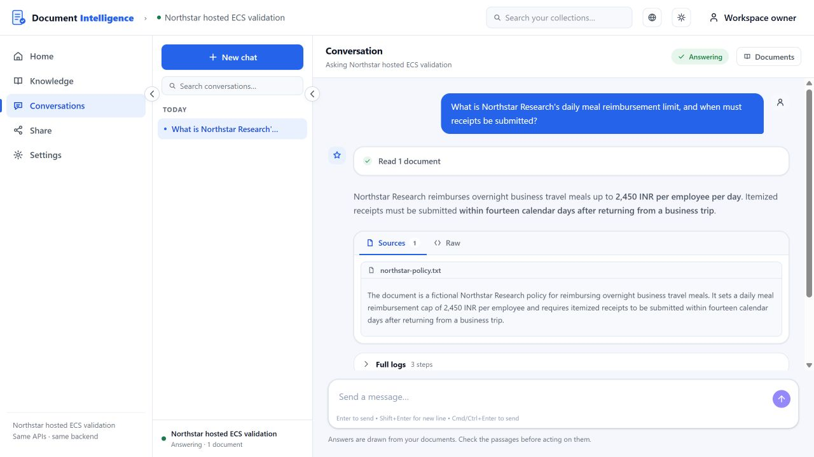

# FutureSmart Document Intelligence

**A working, opinionated Document Intelligence application by [FutureSmart AI](https://futuresmart.ai/), released under Apache-2.0. A complete UI and backend reference application that shows how [AI Demos](https://aidemos.com/) research becomes product improvements.**

Upload documents into a collection, extract the fields you define into a typed
table, and ask questions answered from the documents with their sources. Use the
web application, or call the same ingestion, search and chat API from your own
software.



## How AI Demos research improves Document Intelligence

We test this application in the [AI Demos](https://aidemos.com/) Structured
Document Extraction and Managed RAG benchmarks, then use what the testing finds
to improve it. The [improvement history](docs/improvements/README.md) connects
findings, engineering decisions, code and verification, and keeps the failures.
Each entry names the benchmark it came from; the two benchmarks are reported
separately and never combined into one score.

### Example: a search that left its scope

**What testing found.** A caller restricted a question to a chosen subset of
documents. When that subset held no answer, retrieval fell back and answered
from a document outside the requested scope.

**What we improved.** Explicit document IDs are now a hard boundary on every
retrieval path. An empty, unknown, deleted or foreign selection returns no
matches instead of broadening to the whole collection. Unsupported filters are
rejected instead of silently ignored. [Read the decision, code and checks](docs/improvements/history.md#di-001).

**What we verified.** Focused scope contracts run against a real Qdrant in CI,
with separate direct API and browser checks. These are engineering checks, not
a new independently graded benchmark run.

**Managed RAG · Engineering correction released · Benchmark result for this scenario not yet published on AI Demos.**

**Published so far.** Structured Document Extraction: one result, [a cleanly
scanned document, Pass](https://aidemos.com/benchmarks/structured-document-extraction/results/futuresmart-document-intelligence/a-cleanly-scanned-document).
Managed RAG: no result published yet. The [baseline](docs/improvements/baseline.md)
lists what is and is not published.

[Explore all research-driven findings and engineering outcomes →](docs/improvements/README.md)

We prioritize a dependable, deployable product and reproducible evidence over
commercial feature parity or a higher benchmark score.

## A complete reference application, not just a library

One repository contains the FastAPI backend, the Next.js web application, the
Celery ingestion/indexing worker, deployment configuration, tests and examples.
The supported stack is Docker Compose with PostgreSQL, Qdrant, Redis and S3/SQS
(LocalStack locally, real AWS for durable deployments). The web UI is optional;
the worker is required.

What it does:

- **Collections and ingestion.** PDF, DOCX, TXT, Markdown, HTML, web pages and
  audio. Text-based files and web pages are read locally; scanned, layout and
  visual modes use an optional LlamaParse key, and Firecrawl is an optional
  scraper.
- **Structured extraction.** Define fields with types and descriptions; each
  document's values appear in a typed table you can inspect and export as CSV.
- **Grounded answers.** Ask questions about a collection or chosen documents and
  see which documents the answer used. The search API returns the matching
  passages themselves.
- **RAG as a service.** Authenticated REST API for ingestion, search and chat,
  with OpenAPI docs and a server-side example client.

## Install

You need Git, Docker with Compose v2, Python 3, and one `OPENAI_API_KEY`.

```sh
git clone https://github.com/FutureSmart-AI/document-intelligence.git
cd document-intelligence
export OPENAI_API_KEY=...   # keep it private; PowerShell: $env:OPENAI_API_KEY="..."
python deploy/configure.py
docker compose --profile ui up -d --build
docker compose ps -a
```

`configure.py` writes a private `.env` with generated secrets and the default
`openai-v1` [model profile](docs/configuration.md#model-profiles), and refuses to
overwrite an existing one. The first build downloads large Python dependencies.
`api-init` and `worker-init` exit with code 0; `api`, `worker` and `ui` stay running.

## Try it

Open **http://localhost:8086/document-intelligence/** and sign in with
`STANDALONE_PASSWORD` from `.env`. No FutureSmart account is needed.

1. Create a collection and add extraction fields, for example
   `daily_meal_limit_inr` (number) and `receipt_deadline_days` (number).
2. Upload `examples/northstar-policy.txt` and wait for **Completed**.
3. Inspect the extracted values (2450 and 14), then ask: *What is the daily
   meal limit, and how long do employees have to submit receipts?* Open
   **Sources** to see which document the answer used.

## Use the API without the UI

```sh
docker compose up -d --build
python examples/rag_service.py --env-file .env
```

The example authenticates, creates and configures a collection, uploads a
document, waits for indexing, retrieves chunks and calls the grounded chat
endpoint, checking the returned facts. The API is **http://localhost:8000**,
with interactive docs at `/docs`. See the [service API guide](docs/api/rag-service.md)
and [extraction context](docs/api/extraction-context.md).

## Stop and restart

```sh
docker compose --profile ui stop
docker compose --profile ui up -d
```

Collections, extracted values and vectors persist in named volumes. LocalStack
is a disposable S3/SQS emulator: restarting it loses original uploads and queued
work. Use the [AWS-backed overlay](docs/deployment/aws.md) for durable files and
queues. Never use `down -v` as a rollback. See [installation](docs/installation.md).

## Guides

[Installation](docs/installation.md) · [Configuration and model profiles](docs/configuration.md) ·
[Architecture](docs/architecture.md) · [Development](docs/development.md) ·
[AWS ECS/Fargate deployment](docs/deployment/aws.md) · [Publication and source export](docs/publication.md)

| Directory | Purpose |
| --- | --- |
| `backend/` | API, RAG engine, packaged configuration and migrations |
| `frontend/` | Optional web UI and its API contract |
| `workers/` | Required ingestion/indexing worker |
| `deploy/` | Configuration, model profiles, containers and source export |
| `docs/` | Installation, API, architecture, deployment and improvement history |
| `tests/`, `examples/`, `evals/` | Regressions, fixtures, API client and a grounded-answer check |

## Known limits

- Questions that must enumerate or total every document in a collection can
  miss or merge records. A fix is in progress and not released
  ([DI-004](docs/improvements/history.md#di-004)).
- Learning extraction rules from labelled examples and correcting extracted
  values back into stored records are not implemented
  ([DI-DEC-001](docs/improvements/history.md#di-dec-001)).
- The web UI's **Sources** panel lists the documents an answer used, with a
  summary of each, not the supporting passage. There is no field-level source
  span or calibrated confidence ([DI-DEC-002](docs/improvements/history.md#di-dec-002)).
- Home cards can show a document's update time several hours off, apparently a
  time-zone display issue.
- Installation proves the application runs; it does not establish extraction
  accuracy or RAG quality on your documents. Evaluate on your own data.
- Configured model providers receive document text, questions and retrieved
  passages, even when you self-host.
- Hosted FutureSmart sign-in, usage metering and integrations remain in the
  source and are off in the standalone profile ([details](docs/publication.md#retained-hosted-code)).

## License and provenance

Apache-2.0; see [LICENSE](LICENSE) and [NOTICE](NOTICE). Bundled fonts keep their
SIL Open Font License notices. This repository is a clean source snapshot with
fresh history; see [publication and source export](docs/publication.md).
